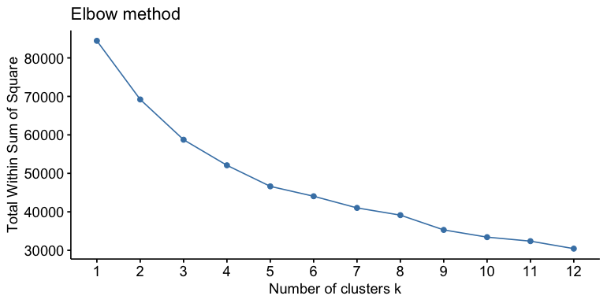
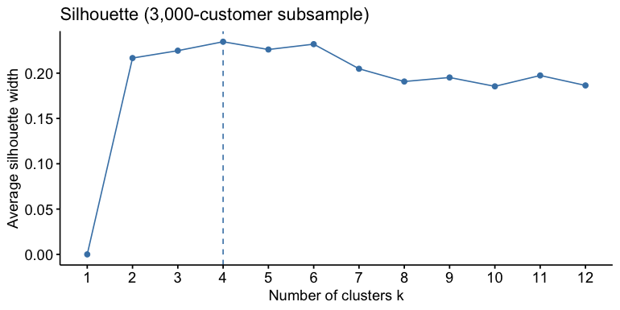
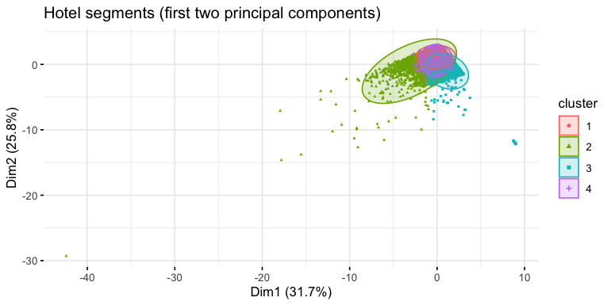
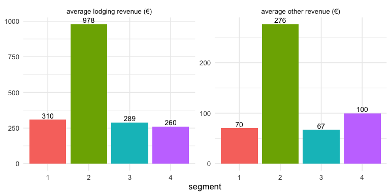
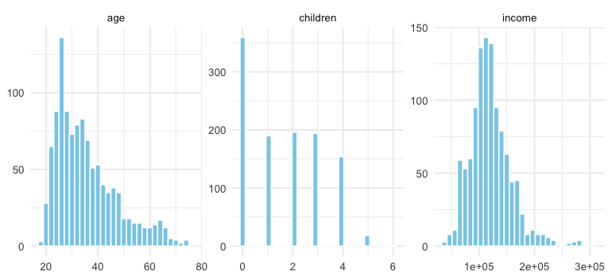
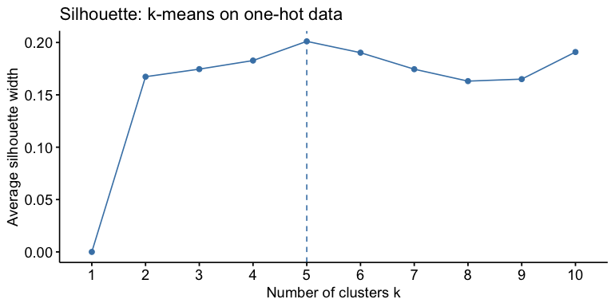
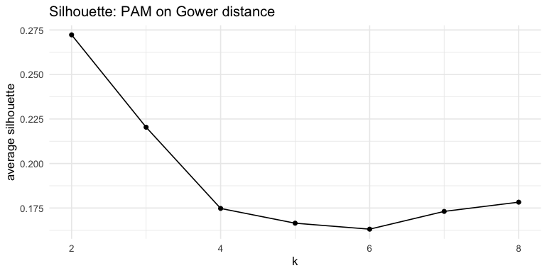

Customer segmentation with k-means: hotel guests and app users, and when
k-means misleads
================

- [A. Hotel guests](#a-hotel-guests)
  - [A1. Data](#a1-data)
  - [A2. How many clusters?](#a2-how-many-clusters)
  - [A3. Four-segment solution](#a3-four-segment-solution)
  - [A4. Robustness: the effect of skewed
    revenue](#a4-robustness-the-effect-of-skewed-revenue)
  - [A5. What this means for the
    hotel](#a5-what-this-means-for-the-hotel)
- [B. Social-app users: k-means vs Gower +
  PAM](#b-social-app-users-k-means-vs-gower--pam)
  - [B1. Data](#b1-data)
  - [B2. k-means on one-hot encoded
    data](#b2-k-means-on-one-hot-encoded-data)
  - [B3. Gower distance + PAM](#b3-gower-distance--pam)
  - [B4. Takeaways](#b4-takeaways)
- [Summary](#summary)

This notebook segments customers in two settings:

- **A. Hotel guests** (behavioural data, all numeric): which guest
  segments bring in the most lodging and ancillary revenue, and how
  should the hotel target them?
- **B. Users of a social app** (demographic data, mostly categorical):
  what user types exist?

Part B also shows a common pitfall. Running k-means on one-hot encoded
categorical variables lets a single binary variable drive the
clustering. The result is then compared with a method designed for mixed
data: Gower distance with PAM (k-medoids).

``` r
library(tidyverse)
library(factoextra)
library(cluster)
library(knitr)
set.seed(123)

# share of each variable's variance explained by the clustering (between-cluster SS / total SS)
separation <- function(X, cl) {
  X <- as.data.frame(X)
  sapply(X, function(x) 1 - sum(tapply(x, cl, function(v) sum((v - mean(v))^2))) / sum((x - mean(x))^2))
}
```

# A. Hotel guests

## A1. Data

The data is a sample of 10,001 customers of a Lisbon hotel (Antonio, de
Almeida & Nunes, 2020, *Data in Brief*). Customers with a missing or
implausible age (under 18 or over 95) are removed. Segmentation uses
nine behavioural variables.

``` r
hotel <- read.csv("data/HotelCustomersSubset_sample.csv") |>
  mutate(Age = suppressWarnings(as.numeric(Age))) |>
  filter(!is.na(Age), Age >= 18, Age <= 95)

seg_vars <- c("Age", "AverageLeadTime", "DaysSinceCreation", "LodgingRevenue", "OtherRevenue",
              "PersonsNights", "RoomNights", "DaysSinceLastStay", "DaysSinceFirstStay")
cat(nrow(hotel), "customers after cleaning\n")
```

    ## 9384 customers after cleaning

``` r
summary(hotel[seg_vars])
```

    ##       Age        AverageLeadTime  DaysSinceCreation LodgingRevenue  
    ##  Min.   :18.00   Min.   :  0.00   Min.   :744.0     Min.   :   0.0  
    ##  1st Qu.:37.00   1st Qu.: 20.00   1st Qu.:790.0     1st Qu.: 168.0  
    ##  Median :49.00   Median : 62.00   Median :827.0     Median : 285.9  
    ##  Mean   :48.51   Mean   : 96.41   Mean   :825.6     Mean   : 364.9  
    ##  3rd Qu.:58.00   3rd Qu.:156.00   3rd Qu.:862.0     3rd Qu.: 437.1  
    ##  Max.   :92.00   Max.   :409.00   Max.   :902.0     Max.   :7458.0  
    ##   OtherRevenue     PersonsNights       RoomNights      DaysSinceLastStay
    ##  Min.   :   0.00   Min.   :  0.000   Min.   :  0.000   Min.   : -1.0    
    ##  1st Qu.:  31.93   1st Qu.:  3.000   1st Qu.:  2.000   1st Qu.:792.0    
    ##  Median :  64.50   Median :  6.000   Median :  3.000   Median :828.0    
    ##  Mean   :  95.70   Mean   :  6.397   Mean   :  3.121   Mean   :822.9    
    ##  3rd Qu.: 116.50   3rd Qu.:  8.000   3rd Qu.:  4.000   3rd Qu.:864.0    
    ##  Max.   :3580.50   Max.   :116.000   Max.   :116.000   Max.   :916.0    
    ##  DaysSinceFirstStay
    ##  Min.   :  -1.0    
    ##  1st Qu.: 793.0    
    ##  Median : 829.0    
    ##  Mean   : 827.2    
    ##  3rd Qu.: 865.0    
    ##  Max.   :1075.0

Two things matter before clustering: - **The variables are on very
different scales.** Euros, days and counts all appear, and k-means uses
Euclidean distance. All variables are therefore standardised. - **Three
variables measure almost the same thing.** Most customers stayed only
once, so “days since first stay”, “days since last stay” and “days since
account creation” are nearly identical. Tenure therefore counts about
three times in the distance:

``` r
round(cor(hotel[, c("DaysSinceCreation", "DaysSinceLastStay", "DaysSinceFirstStay")]), 3)
```

    ##                    DaysSinceCreation DaysSinceLastStay DaysSinceFirstStay
    ## DaysSinceCreation              1.000             0.566              0.751
    ## DaysSinceLastStay              0.566             1.000              0.749
    ## DaysSinceFirstStay             0.751             0.749              1.000

## A2. How many clusters?

The silhouette is computed on a random subsample of 3,000 customers. A
full distance matrix for 9,000+ customers would need several GB of
memory.

``` r
hotel_scaled <- scale(hotel[seg_vars])
sub <- hotel_scaled[sample(nrow(hotel_scaled), 3000), ]
fviz_nbclust(hotel_scaled, kmeans, method = "wss", k.max = 12, nstart = 10) + labs(title = "Elbow method")
```



``` r
fviz_nbclust(sub, kmeans, method = "silhouette", k.max = 12, nstart = 10) + labs(title = "Silhouette (3,000-customer subsample)")
```



``` r
wss <- sapply(1:8, function(k) { set.seed(123); kmeans(hotel_scaled, k, nstart = 10, iter.max = 50)$tot.withinss })
tibble(k = 2:8, `drop in within-cluster SS` = -diff(wss)) |> kable(digits = 0)
```

|   k | drop in within-cluster SS |
|----:|--------------------------:|
|   2 |                     15244 |
|   3 |                     10461 |
|   4 |                      6648 |
|   5 |                      5470 |
|   6 |                      3121 |
|   7 |                      2476 |
|   8 |                      1884 |

There is no sharp elbow. Each extra cluster still reduces the
within-cluster sum of squares, but the gains level off: the drop from 4
to 5 clusters is about half the drop from 2 to 3, and it falls again
after that. Four segments are also a manageable number for marketing
actions, so **k = 4** is used. It is run with 25 random starts
(`nstart = 25`), because a single start can get stuck in a poor local
optimum.

## A3. Four-segment solution

``` r
set.seed(123)
km_hotel <- kmeans(hotel_scaled, centers = 4, nstart = 25)
hotel$cluster <- factor(km_hotel$cluster)

profile <- hotel |> group_by(cluster) |>
  summarise(customers = n(), across(all_of(seg_vars), mean),
            total_lodging = sum(LodgingRevenue), total_other = sum(OtherRevenue)) |>
  mutate(share_customers = customers / sum(customers),
         share_lodging = total_lodging / sum(total_lodging),
         share_other = total_other / sum(total_other))
profile |> select(cluster, customers, Age, AverageLeadTime, RoomNights, PersonsNights,
                  LodgingRevenue, OtherRevenue, DaysSinceLastStay) |>
  kable(digits = 1, caption = "Segment profiles (means)")
```

| cluster | customers | Age | AverageLeadTime | RoomNights | PersonsNights | LodgingRevenue | OtherRevenue | DaysSinceLastStay |
|:---|---:|---:|---:|---:|---:|---:|---:|---:|
| 1 | 3379 | 43.2 | 71.5 | 2.6 | 5.5 | 309.5 | 70.1 | 863.7 |
| 2 | 998 | 47.1 | 110.6 | 6.5 | 15.0 | 978.1 | 276.2 | 833.2 |
| 3 | 3504 | 46.6 | 51.4 | 2.8 | 5.2 | 288.5 | 67.2 | 776.4 |
| 4 | 1503 | 65.9 | 247.8 | 2.9 | 5.5 | 260.3 | 100.0 | 832.8 |

Segment profiles (means)

``` r
fviz_cluster(km_hotel, data = hotel_scaled, geom = "point", ellipse.type = "norm", pointsize = 0.6,
             ggtheme = theme_minimal(), main = "Hotel segments (first two principal components)")
```



``` r
profile |> select(cluster, `average lodging revenue (€)` = LodgingRevenue, `average other revenue (€)` = OtherRevenue) |>
  pivot_longer(-cluster) |>
  ggplot(aes(cluster, value, fill = cluster)) + geom_col(show.legend = FALSE) +
  geom_text(aes(label = round(value)), vjust = -0.3, size = 3.2) +
  facet_wrap(~ name, scales = "free_y") + theme_minimal() + labs(x = "segment", y = NULL)
```



**Average vs total revenue.** The segment with the highest revenue *per
customer* is not necessarily the one with the most revenue *in total*.
Targeting decisions need both:

``` r
profile |> transmute(cluster, `share of customers` = share_customers,
                     `share of lodging revenue` = share_lodging, `share of other revenue` = share_other) |>
  kable(digits = 3)
```

| cluster | share of customers | share of lodging revenue | share of other revenue |
|:--------|-------------------:|-------------------------:|-----------------------:|
| 1       |              0.360 |                    0.169 |                  0.136 |
| 2       |              0.106 |                    0.533 |                  0.538 |
| 3       |              0.373 |                    0.157 |                  0.131 |
| 4       |              0.160 |                    0.142 |                  0.195 |

``` r
sort(round(separation(hotel_scaled, km_hotel$cluster), 2), decreasing = TRUE)
```

    ##  DaysSinceCreation    AverageLeadTime DaysSinceFirstStay     LodgingRevenue 
    ##               0.64               0.52               0.43               0.40 
    ##      PersonsNights                Age  DaysSinceLastStay       OtherRevenue 
    ##               0.40               0.28               0.27               0.26 
    ##         RoomNights 
    ##               0.25

The table above shows the share of each variable’s variance that the
segmentation explains. The segments are mostly defined by **tenure**
(the three day-count variables), **stay length and revenue**, and
**booking lead time**. Age plays a smaller role.

## A4. Robustness: the effect of skewed revenue

Revenue and nights are strongly right-skewed: lodging revenue has a mean
of about €365 and a maximum of about €7,500. In Euclidean distance, a
few very large spenders can pull a centroid towards them. Re-running
k-means on log-transformed versions shows how much the segments depend
on this.

``` r
skewed <- c("AverageLeadTime", "LodgingRevenue", "OtherRevenue", "PersonsNights", "RoomNights")
hotel_log <- hotel[seg_vars] |> mutate(across(all_of(skewed), log1p)) |> scale()
set.seed(123)
km_log <- kmeans(hotel_log, centers = 4, nstart = 25)

adjusted_rand <- function(a, b) {
  t <- table(a, b); n <- sum(t); s <- function(x) sum(choose(x, 2))
  expected <- s(rowSums(t)) * s(colSums(t)) / choose(n, 2)
  (s(t) - expected) / ((s(rowSums(t)) + s(colSums(t))) / 2 - expected)
}
table(original = km_hotel$cluster, `log-transformed` = km_log$cluster)
```

    ##         log-transformed
    ## original    1    2    3    4
    ##        1 2063 1209    0  107
    ##        2  744    0    0  254
    ##        3    2 1012   16 2474
    ##        4  720  128    0  655

``` r
cat(sprintf("Adjusted Rand index between the two solutions: %.2f (1 = identical, 0 = chance agreement)\n",
            adjusted_rand(km_hotel$cluster, km_log$cluster)))
```

    ## Adjusted Rand index between the two solutions: 0.27 (1 = identical, 0 = chance agreement)

The agreement is low (ARI ≈ 0.27). Most of the high-value segment
(segment 2) merges with segment 1 on the log scale. That segment is
therefore defined by the **long tail of large spenders**. For revenue
targeting this is acceptable, because the tail is exactly what
management cares about. But the segment boundaries depend on how revenue
is scaled, and they should be presented as indicative rather than as
fixed customer “types”.

## A5. What this means for the hotel

**The four segments:** - **Segment 2: high-value long stays.** 11% of
guests, but **53% of lodging and 54% of ancillary revenue**. Guests stay
about 6.5 room nights with about 15 person-nights, so they are often
groups or families, and they book about 110 days ahead. - **Segment 4:
older early planners.** Average age 66, booking about 250 days ahead.
Lodging revenue is average, but ancillary spend is relatively high: €100
against €260 lodging, the highest ratio of the four segments. -
**Segments 1 and 3: short, low-spend stays.** Together 73% of guests.
They differ mainly in how long ago they became customers.

**Two recommendations:** 1. **Target segment 2 with retention and
pre-arrival upselling.** One in ten guests brings in half the revenue,
so keeping them matters more than finding new ones. The long booking
horizon leaves time for pre-arrival offers such as room upgrades, family
suites and dining packages, and for direct-booking incentives that cut
commission costs on the most valuable stays. 2. **Position spa and
dining packages for segment 4.** These guests plan far ahead and already
spend proportionally more on extras. Early-booking packages that bundle
the room with F&B or spa credit fit their behaviour. They can be
marketed at the time of booking, months before the stay.

# B. Social-app users: k-means vs Gower + PAM

## B1. Data

There are 1,113 users of a social networking app: - **Binary:** sex,
marital status. - **Categorical:** education, occupation, town size,
sports-fan type. - **Numeric:** age, income, number of children.

``` r
load("data/CustomerSegmentation.RData")   # data frame `df`
app <- df
str(app)
```

    ## 'data.frame':    1113 obs. of  9 variables:
    ##  $ sex       : Factor w/ 2 levels "0","1": 2 2 2 1 2 2 1 2 1 1 ...
    ##  $ married   : Factor w/ 2 levels "0","1": 2 2 2 1 2 2 1 2 2 1 ...
    ##  $ age       : int  26 25 33 41 28 33 49 36 49 29 ...
    ##  $ education : Factor w/ 4 levels "0","1","2","3": 2 2 2 2 2 2 2 2 3 1 ...
    ##  $ income    : int  129022 61907 133561 143994 133799 131492 188594 92723 144461 84531 ...
    ##  $ occupation: Factor w/ 3 levels "0","1","2": 2 1 2 3 2 2 2 1 2 1 ...
    ##  $ townsize  : Factor w/ 3 levels "0","1","2": 1 1 2 3 3 1 2 1 3 1 ...
    ##  $ children  : num  2 2 0 4 4 2 0 3 4 0 ...
    ##  $ sports_fan: Factor w/ 4 levels "0","1","2","3": 3 3 3 1 2 1 4 3 2 2 ...

``` r
app |> summarise(across(c(age, income, children), list(mean = mean, sd = sd))) |> kable(digits = 1)
```

| age_mean | age_sd | income_mean | income_sd | children_mean | children_sd |
|---------:|-------:|------------:|----------:|--------------:|------------:|
|     36.1 |   11.8 |    120866.6 |   37771.9 |           1.7 |         1.5 |

``` r
app |> select(age, income, children) |> pivot_longer(everything()) |>
  ggplot(aes(value)) + geom_histogram(bins = 30, fill = "skyblue", colour = "white") +
  facet_wrap(~ name, scales = "free") + theme_minimal() + labs(x = NULL, y = NULL)
```



## B2. k-means on one-hot encoded data

This is the standard recipe: log-transform income, one-hot encode the
categories, standardise everything, then run k-means. The elbow and
silhouette both point to **k = 3**.

``` r
app_num <- app |> mutate(income = log1p(income))
dummies <- as.data.frame(model.matrix(~ . - 1, data = app_num))
dummies <- dummies[, apply(dummies, 2, var) > 0]
app_scaled <- scale(dummies)

fviz_nbclust(app_scaled, kmeans, method = "silhouette", k.max = 10, nstart = 10) + labs(title = "Silhouette: k-means on one-hot data")
```



``` r
set.seed(123)
km_app <- kmeans(app_scaled, centers = 3, nstart = 25)

profile_app <- function(cl) app |> mutate(cluster = factor(cl)) |> group_by(cluster) |>
  summarise(users = n(), age = mean(age), income = mean(income), children = mean(children),
            `% female` = 100 * mean(sex == "1"), `% married` = 100 * mean(married == "1"))
profile_app(km_app$cluster) |> kable(digits = 1, caption = "k-means segments (k = 3)")
```

| cluster | users |  age |   income | children | % female | % married |
|:--------|------:|-----:|---------:|---------:|---------:|----------:|
| 1       |   184 | 55.0 | 143859.7 |      2.2 |     51.6 |      66.8 |
| 2       |   404 | 29.1 | 106921.2 |      1.7 |    100.0 |      77.2 |
| 3       |   525 | 35.0 | 123539.3 |      1.5 |      0.0 |      21.1 |

k-means segments (k = 3)

**The problem.** Two of the three segments are 100% one sex. Which
variables drive the split?

``` r
sort(round(separation(app_scaled, km_app$cluster), 2), decreasing = TRUE)[1:8]
```

    ## education2       sex0       sex1        age education1   married1     income 
    ##       0.89       0.83       0.83       0.56       0.48       0.28       0.11 
    ## education3 
    ##       0.08

Each k-means segment is essentially **one dummy column**: - segment 1 is
the users with the highest education levels (`education2/3`); - segments
2 and 3 are everyone else, split exactly by sex.

``` r
table(`k-means segment` = km_app$cluster, education = app$education)
```

    ##                education
    ## k-means segment   0   1   2   3
    ##               1   0   0 166  18
    ##               2  22 382   0   0
    ##               3 139 386   0   0

``` r
table(`k-means segment` = km_app$cluster, sex = app$sex)
```

    ##                sex
    ## k-means segment   0   1
    ##               1  89  95
    ##               2   0 404
    ##               3 525   0

The reason is mechanical. A standardised 0/1 variable is far from the
mean for *every* observation (about ±1 SD), while a continuous variable
is far from its mean only for its extreme values. So binary dummies
contribute large, constant distances, and k-means is drawn to split
along them. Each extra dummy column of a categorical variable also adds
weight to that variable. The “segments” here are partly an artefact of
the encoding.

## B3. Gower distance + PAM

**Gower distance** handles mixed data directly: - numeric variables
contribute their range-normalised absolute difference; - categorical
variables contribute 0 if two users match and 1 if they differ; - every
variable gets the same weight, regardless of how many levels it has.

**PAM** (partitioning around medoids) clusters on any distance matrix,
and its cluster centres are real users (medoids).

``` r
gower <- daisy(app, metric = "gower")
sil_width <- sapply(2:8, function(k) pam(gower, k = k, diss = TRUE)$silinfo$avg.width)
tibble(k = 2:8, `average silhouette` = sil_width) |>
  ggplot(aes(k, `average silhouette`)) + geom_line() + geom_point() + theme_minimal() +
  labs(title = "Silhouette: PAM on Gower distance")
```



``` r
k_best <- (2:8)[which.max(sil_width)]
cat("best k by silhouette:", k_best, "\n")
```

    ## best k by silhouette: 2

``` r
pam_app <- pam(gower, k = k_best, diss = TRUE)
profile_app(pam_app$clustering) |> kable(digits = 1, caption = sprintf("PAM segments (k = %d)", k_best))
```

| cluster | users |  age |   income | children | % female | % married |
|:--------|------:|-----:|---------:|---------:|---------:|----------:|
| 1       |   541 | 32.5 | 113128.7 |      1.8 |     84.3 |      88.9 |
| 2       |   572 | 39.6 | 128185.0 |      1.6 |      7.5 |      11.4 |

PAM segments (k = 2)

``` r
app[pam_app$medoids, ] |> mutate(cluster = seq_len(k_best), .before = 1) |>
  kable(caption = "Medoids: the most representative user of each segment")
```

|  | cluster | sex | married | age | education | income | occupation | townsize | children | sports_fan |
|:---|---:|:---|:---|---:|:---|---:|:---|:---|---:|:---|
| 357 | 1 | 1 | 1 | 31 | 1 | 106637 | 1 | 0 | 2 | 0 |
| 128 | 2 | 0 | 0 | 38 | 1 | 124487 | 1 | 0 | 2 | 2 |

Medoids: the most representative user of each segment

``` r
pam_drivers <- sapply(app, function(x) {
  if (is.numeric(x)) summary(aov(x ~ factor(pam_app$clustering)))[[1]][1, "Sum Sq"] / sum((x - mean(x))^2)
  else as.numeric(chisq.test(table(x, pam_app$clustering))$statistic) / (length(x) * (min(nlevels(factor(x)), k_best) - 1))
})
sort(round(pam_drivers, 2), decreasing = TRUE)
```

    ##    married        sex  education        age   townsize sports_fan     income 
    ##       0.60       0.59       0.11       0.09       0.05       0.05       0.04 
    ## occupation   children 
    ##       0.03       0.00

The final table shows the strength of each variable’s association with
the PAM segments: R² for numeric variables and Cramér’s V² for
categorical ones.

``` r
table(`k-means` = km_app$cluster, PAM = pam_app$clustering)
```

    ##        PAM
    ## k-means   1   2
    ##       1  93  91
    ##       2 369  35
    ##       3  79 446

``` r
cat(sprintf("Adjusted Rand index k-means vs PAM: %.2f\n", adjusted_rand(km_app$cluster, pam_app$clustering)))
```

    ## Adjusted Rand index k-means vs PAM: 0.40

**Is the sex split then just an artefact?** Not entirely. PAM on Gower
distance also separates users mainly by **marital status and sex
together**: - one segment is mostly married women; - the other is mostly
single men, who are somewhat older and earn more.

The two variables are genuinely linked in this sample:

``` r
round(prop.table(table(sex = app$sex, married = app$married), 1), 2)
```

    ##    married
    ## sex    0    1
    ##   0 0.76 0.24
    ##   1 0.21 0.79

79% of women are married against 24% of men. The two methods describe
this structure differently: - k-means turns it into exact 100% / 0%
partitions on single dummy columns and adds a separate education
split; - PAM shows it as a soft combination of two related traits, with
every other variable weighted equally.

## B4. Takeaways

- With mostly categorical data, **k-means on one-hot dummies produces
  segments that copy individual dummy columns**: here, education level
  and sex. They are easy to label, but the hard 0% / 100% boundaries
  come from the encoding, not from the users.
- **Gower distance with PAM** weighs every variable equally, works on
  the original categories, and gives real, representative users as
  segment centres. Here it recovers the structure that *is* real, the
  married-women vs single-men contrast, without the hard partitions. It
  is the better default for demographic data like this.
- Whichever method is used, the segments should be checked by asking
  *which variables drive the split* before they are given names.

# Summary

|  | Hotel guests | App users |
|----|----|----|
| Data | 9 numeric behavioural variables | 2 binary, 4 categorical, 3 numeric |
| Method | k-means (k = 4, 25 starts) on standardised data | k-means on one-hot data vs Gower + PAM |
| Checks | elbow/silhouette, variable separation, log-transform robustness (ARI) | variable drivers, silhouette, ARI between methods |
| Lesson | separate average from total revenue when targeting; tenure variables are triple-counted | binary dummies can dominate k-means; use a mixed-data distance |
